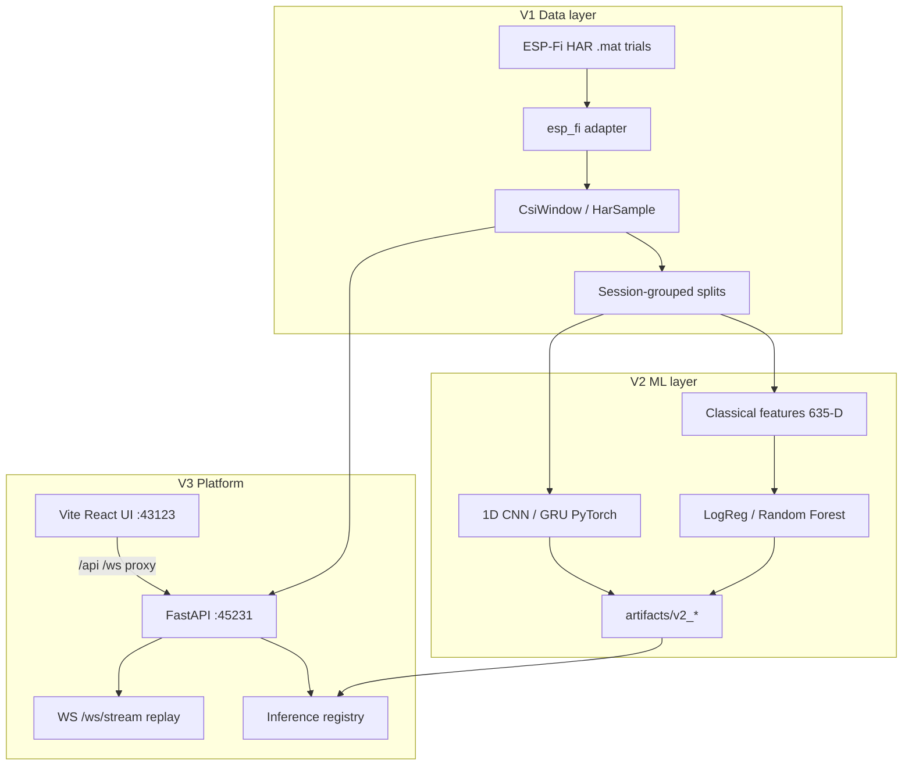

# R-View (WiFi CSI HAR) — What We Built

**Authoring context:** Final-year software project (Ribhu S.).  
**Repository:** [granzer69/RView-WiFi-CSI](https://github.com/granzer69/RView-WiFi-CSI)  
**Status (October 2026):** V1 data foundation, V2 ML engine, and V3 software platform are implemented and signed off for **software-only** delivery (no ESP32 / live hardware).

This document is the single narrative of what exists today: purpose, architecture, measured results, integrity rules, how to run the demo, and known limits. Deeper build guides remain in linked files at the end.

---

## 1. Problem and goals

**Problem:** Recognize human activities (walk, run, fall, etc.) from **Wi-Fi Channel State Information (CSI)** — amplitude changes across OFDM subcarriers over time — without cameras or wearables.

**Project choice:** A **software-first** pipeline that:

1. Ingests a published CSI dataset (ESP-Fi HAR) with strict session-level splitting so evaluation is not leaked.
2. Trains and compares multiple HAR models (classical → deep learning).
3. Delivers a **visual platform** that replays real CSI, shows ground truth, runs **live model inference**, and surfaces evaluation metrics for examiners.

**Explicit non-goals (approved scope):** ESP32 firmware, UART bridges, live over-the-air capture, CSI-Bench automation, multi-room localization productization. See `docs/project-scope.md`.

---

## 2. High-level architecture



**Transport in the demo:**

| Path | Role |
| --- | --- |
| WebSocket `/ws/stream` | Preferred: replay CSI frames + predictions + timeline |
| `POST /predict` | Fallback / tools: classify one amplitude window |
| Exported JSON under `frontend/public/replay/` | Offline UI when API or ESP-Fi path unavailable |

**Integrity labeling in the UI:** Every panel is tagged **REAL DATA**, **MODEL PREDICTION**, or **SIMULATED POSITION** so viewers never confuse dataset CSI with stub floor plans.

---

## 3. Dataset: ESP-Fi HAR

| Property | Value |
| --- | --- |
| License | CC BY 4.0 |
| Location in repo | `data/raw/esp-fi-har/` (gitignored; user extracts archive) |
| Scale | **2,240** trials — grid 4 scenarios × 8 users × 7 activities × 10 trials |
| Matrix | `CSIamp` shape **(950, 52)** — **amplitude only** (no phase in this pipeline) |
| Session ID | Filename stem `user-scenario-activity-trial` (e.g. `1-1-2-1`) |

### Label policy (important for thesis)

- Activity codes **follow published scenario-3 folder layout** (`published_folder_codes_not_readme`), **not** the ESP-Fi README id table (they disagree for codes 2–7; only code 1 “run” aligns).
- Scenarios **1, 2, and 4** have **no class folders** in the extracted tree; labels there are **INFERRED — NOT INDEPENDENTLY VERIFIED** and documented in manifests.
- Secondary datasets (CSI-Bench, Embedded WiFi Sensing HAR) are **documented but gated** — not used in automated training runs.

Inspection outputs: `reports/esp_fi_inspection.json`, `reports/esp_fi_split_methodology.md`, `data/metadata/esp-fi-har.json`.

---

## 4. V1 — Data foundation

**Purpose:** Canonical contracts, leakage-safe splits, preprocessing, and the first simulator shell.

### Core types

| Type | Location | Role |
| --- | --- | --- |
| `CsiWindow` | `src/ingestion/` | One trial: amplitude tensor + metadata |
| `HarSample` | `src/ingestion/ml_contract.py` | ML boundary: amplitude, `label_id`, session/user/env, split |
| `PreprocessConfig` | `src/preprocessing/pipeline.py` | Validate, optional clip/z-score/windowing |

### Split strategies (session-grouped, seed 42)

Holdout uses `floor(n × 0.15)` for val and test. **No trial/session appears in more than one split.**

| Strategy | What is held out | Train / Val / Test |
| --- | --- | ---: |
| `in_domain` | Random sessions | 1792 / 224 / 224 |
| `cross_user` | Entire users | 1680 / 280 / 280 |
| `cross_environment` | Entire scenarios | 1120 / 560 / 560 |

**Locked assignment hashes** (SHA-256 of session→split map) are enforced in training code so splits cannot drift silently. Published `train_amp` / `test_amp` folders are used only as a **leakage check**, not as the primary split.

### V1 tooling

- `scripts/inspect_esp_fi.py` — counts, plots, split methodology report  
- `python3 -m pytest` — **47** tests covering ingestion, splits, preprocessing, simulator, API  

### V1 limitations (by design)

- Default preprocessing is **validate-only** (full 950×52 trial per sample).  
- No hardware path.  
- Simulator spatial view is **simulated**, not localization.

---

## 5. V2 — ML / HAR engine

**Purpose:** Comparable model ladder on identical splits, with saved artifacts and measured reports.

**Build guide:** `docs/v2-engine-build-guide.md`

### Model ladder

| Family | Input | Notes |
| --- | --- | --- |
| Logistic regression | 635-D `classical_v1` features | Fast baseline; best **cross_user** macro-F1 in current runs |
| Random forest | Same features | Default V3 model; best **in_domain**; ~170 MB artifacts |
| 1D CNN | Raw `(52, 950)` channels-first | PyTorch |
| GRU | Raw `(950, 52)` time-major | PyTorch |

**Classical features (`classical_v1`):** Per-subcarrier statistics, global histogram entropy, spectral RFFT stats. Scaler fit **on train only**.

**Deep models:** Amplitude normalizer fit **on train only**; same leakage rules as classical path.

### Measured test macro-F1 (headline)

| Model | In-domain | Cross-user | Cross-environment |
| --- | ---: | ---: | ---: |
| Random forest | **0.7668** | 0.3349 | 0.2912 |
| Logistic regression | 0.5385 | **0.3974** | 0.2564 |
| 1D CNN | 0.4414 | 0.2263 | 0.2342 |
| GRU | 0.2126 | 0.1315 | 0.1777 |

Full tables, confusion matrices, and train/val breakdowns: `reports/v2_*_results.md` and `artifacts/v2_*/<run_id>/<strategy>/metrics.json`.

### Artifacts layout

```
artifacts/
  v2_logreg/<run_id>/<strategy>/   # sklearn bundle + metrics
  v2_rf/<run_id>/<strategy>/
  v2_cnn1d/<run_id>/<strategy>/    # weights + config
  v2_gru/<run_id>/<strategy>/
```

Training entry points: `scripts/train_logreg.py`, `train_rf.py`, `train_cnn1d.py`, `train_gru.py`.  
Evaluation JSON for UI: `scripts/export_evaluation_summary.py` → `frontend/public/evaluation/summary.json`.

### V2 observations (for thesis)

- Random forest reaches **100% train accuracy** — strong memorization; generalization to new users/rooms remains weak.  
- **Cross-user** is the hardest axis; logreg beats RF there.  
- Deep models underperformed RF on this default preprocess (full-trial, minimal augmentation) — a documented finding, not a silent failure.

---

## 6. V3 — Software platform and UI

**Purpose:** Turn artifacts into a demonstrable product: API + WebSocket replay + React dashboard.

**Build guide:** `docs/v3-platform-build-guide.md`  
**UI design:** `docs/csi-activity-simulator-design.md`

### Backend (FastAPI, port **45231**, host `0.0.0.0`)

| Method | Path | Description |
| --- | --- | --- |
| `GET` | `/health` | Liveness, active model, load errors |
| `GET` | `/models` | Discover all V2 strategy folders |
| `PUT` | `/models/active` | Switch active artifact |
| `GET` | `/replay/manifest` | Session catalog from `RVIEW_DATA_ROOT` |
| `POST` | `/predict` | Classify amplitude window (max 950×52) |
| `WS` | `/ws/stream` | Replay + `csi_frame` + `prediction` + `timeline` |

Default active model: `artifacts/v2_rf/20261010T060000Z/in_domain`.

Key modules: `src/api/main.py`, `inference.py`, `model_registry.py`, `replay_stream.py`, `replay_manifest.py`. Replay engine shares `src/simulator/sources/dataset_replay.py` with tests.

### Frontend (Vite + React + TypeScript + Tailwind, port **43123**)

**Product name in UI:** Visual CSI Activity Simulator (R-View WiFi CSI — V3, no hardware).

| Area | Behavior |
| --- | --- |
| **Live replay** | Session picker, play/pause/speed, CSI heatmap, timeline |
| **ACTIVITY** | Ground truth vs model; confidence and latency |
| **SPATIAL** | Top-down floor plan — **simulated** (`spatial.simulated: true`) |
| **SYSTEM** | Model status, transport hints |
| **Evaluation** (`/evaluation`) | Offline metrics from exported summary JSON |
| **Research Lab** (`/research`) | Generalization gaps, participant test metrics, personalization protocol |
| **Model picker** | Switch logreg / RF / CNN / GRU and split strategy via API |

Proxy: `frontend/vite.config.ts` forwards `/api` and `/ws` to `127.0.0.1:45231`.

### Running the examiner demo

```bash
# From repo root
python3 -m pip install -e ".[dev,ml]"
bash scripts/dev-stack.sh start-preview   # recommended for Cursor internal browser
bash scripts/dev-stack.sh status
python3 scripts/export_evaluation_summary.py   # refresh /evaluation data
python3 scripts/export_research_lab.py         # refresh /research generalization JSON
python3 scripts/export_participant_profiles.py # refresh participant + personalization JSON
```

**Cursor Cloud:** Forward **43123** (UI) and **45231** (API); open internal browser via Forwarded Ports **globe** on 43123. See `docs/cursor-in-app-browser.md` (Vite dev HMR is disabled for forwarding; `start-preview` serves a production bundle for stability).

### V3 acceptance checklist (from scope)

1. Start API + UI.  
2. Play a session — heatmap + predictions update.  
3. Switch models in sidebar.  
4. Open Evaluation for split metrics.  
5. No physical hardware required.

---

## 7. Repository map (mental model)

| Path | Role |
| --- | --- |
| `src/ingestion/`, `src/datasets/`, `src/preprocessing/` | V1 data |
| `src/models/`, `src/training/`, `src/evaluation/` | V2 ML |
| `src/api/`, `src/simulator/` | V3 platform + replay |
| `frontend/` | React UI |
| `configs/` | YAML experiments and preprocess |
| `scripts/` | Inspect, train, export, `run_api.py`, `dev-stack.sh` |
| `artifacts/` | Trained models (versioned run IDs) |
| `reports/` | Measured experiment and inspection markdown |
| `src/research/` | Generalization gaps, participant profiling helpers |
| `tests/` | Pytest suite (includes `test_research_*.py`) |
| `docs/` | Scope, build guides, research lab methodology, this document |

---

## 8. Testing and quality

- **Unit/integration:** `python3 -m pytest` (ingestion, splits, preprocessing, simulator session, API v3, replay).  
- **Frontend:** `cd frontend && npm run build` (TypeScript + Vite production build).  
- **Split integrity:** Assignment hash verification in training loaders.  
- **Label integrity:** Manifest `label_note` and UI copy for inferred scenarios.

---

## 9. Achievements (what you can claim)

1. **End-to-end software HAR pipeline** from published CSI trials to interactive demo.  
2. **Leakage-aware evaluation** with three generalization axes and locked split hashes.  
3. **Four model families** with reproducible artifacts and auto-generated reports.  
4. **Honest integrity UX** — real CSI vs model vs simulated spatial clearly labeled.  
5. **WebSocket-first replay** with HTTP fallback and exported trial JSON for resilience.  
6. **Documented label ambiguity** on ESP-Fi rather than hiding README vs folder mismatch.  
7. **Cloud-agent dev workflow** documented for Cursor port forwarding and preview.

---

## 10. Limitations (what to disclose)

| Area | Limitation |
| --- | --- |
| Data | Amplitude-only; no phase; ESP-Fi only in training runs |
| Labels | Inferred codes for scenarios 1, 2, 4; README mismatch documented |
| Generalization | Cross-user / cross-environment macro-F1 ≈ 0.25–0.40 with current features |
| Deep learning | CNN/GRU below RF on default full-trial setup |
| RF | Large artifacts, train memorization, slower inference than logreg |
| Hardware | None — replay stands in for live sensing |
| Spatial UI | Not localization; illustrative only |
| Real-time | Replay clock is nominal Hz; not verified against MAT capture timestamps |

---

## 11. Suggested next work (not yet built)

Aligned with project roadmap discussion **before** generalization study “item 1”:

1. **Generalization study** — confusion analysis + one controlled preprocess/feature change.  
2. **Streaming windows in live UI** — classify sliding windows during replay.  
3. **Uncertainty UX** — low-confidence states when splits are hard.  
4. **Richer evaluation page** — side-by-side models and split narrative for thesis.

---

## 12. Related documentation

| Document | Contents |
| --- | --- |
| **`docs/SETUP.md`** | **Clone, install, dataset, run commands, env vars, troubleshooting** |
| `docs/project-scope.md` | Approved in/out of scope |
| `docs/v2-engine-build-guide.md` | Splits, features, training commands |
| `docs/v3-platform-build-guide.md` | API, WebSocket protocol, env vars, demo script |
| `docs/cursor-in-app-browser.md` | Port forwarding and `dev-stack.sh` |
| `docs/csi-activity-simulator-design.md` | UI architecture and buffers |
| `data/README.md` | Dataset paths and licenses |
| `README.md` | Quick start commands |

---

## 13. Version history (milestones)

| Milestone | Delivery |
| --- | --- |
| **V1** | ESP-Fi adapter, splits, preprocess, inspection reports, simulator core, initial UI |
| **V2** | LogReg → RF → CNN → GRU, artifacts, `reports/v2_*_results.md` |
| **V3** | FastAPI + WS replay, model registry, live predictions, evaluation page, scope lock (no hardware) |
| **Ops** | `dev-stack.sh`, Cursor preview mode (`start-preview`), GitHub `granzer69/RView-WiFi-CSI` |

---

*This file should be updated when new experiments or platform features ship; measured numbers must always point to `reports/` and `artifacts/` rather than hand-edited tables.*
